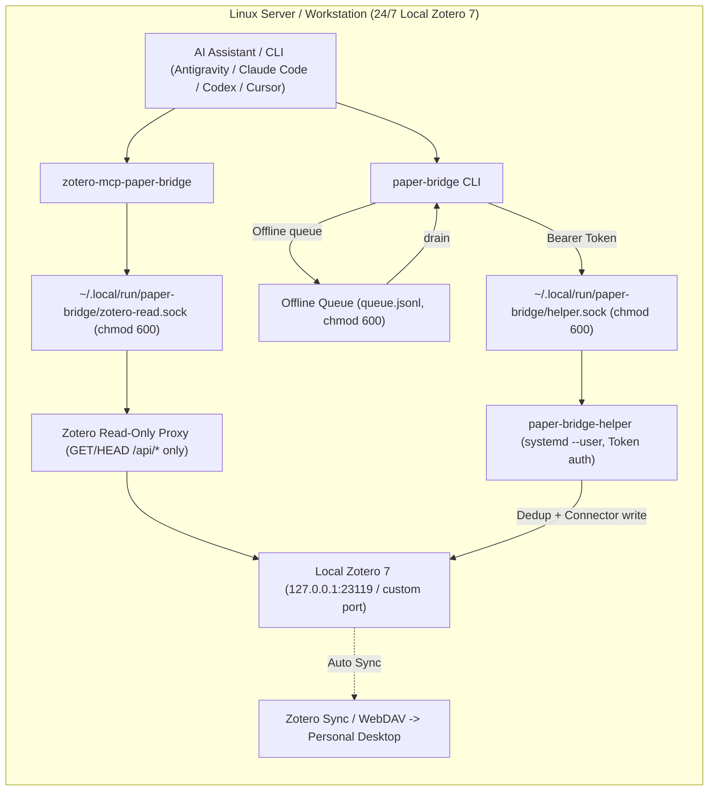

<p align="center">
  
</p>

<h1 align="center">zotero-paper-bridge</h1>

<p align="center">
  <strong>Zero-dependency local Linux daemon and CLI for ingesting IEEE Xplore, arXiv, DOI, and BibTeX papers into local Zotero 7, with private read-only MCP full-text access.</strong>
</p>

<p align="center">
  English | <a href="README.zh-CN.md">简体中文</a>
</p>

---

## Why `zotero-paper-bridge`?

When researching papers with AI coding assistants on a **Linux workstation or campus GPU server** running Zotero 7 locally (24/7, synced to your personal computer via Zotero Sync / WebDAV), you need a safe, reliable bridge between AI tools and Zotero:

1. **Direct 24/7 ingestion without desktop tunnels**: The helper runs locally on your Linux host, directly fetching IEEE Xplore (campus IP), arXiv, and Open Access PDFs into local Zotero 7 without needing a laptop online.
2. **Safe isolation on shared Linux servers**: Both the ingestion helper and Zotero MCP read-back listen on `chmod 0600` Unix Domain Sockets inside a `chmod 0700` directory (`~/.local/run/paper-bridge/`):
   - Ingestion channel (`helper.sock`): mandatory **256-bit Bearer Token** (`chmod 600`), verified in constant time.
   - Full-text read-back channel (`zotero-read.sock`): **read-only proxy** forwarding only `GET`/`HEAD /api/*` and rejecting all `POST`/`PUT`/`DELETE`/`PATCH` and `/connector/*` calls with `HTTP 403`.
3. **Compliant tiered ingestion + PDF metadata enrichment**:
   - Pre-deduplicates against local Zotero 7 and writes via the local Connector API (no Zotero cloud storage quota used; attachments sync naturally via WebDAV or local storage).
   - **Tier 1 (arXiv / Open Access)**: Direct download; gracefully falls back to `/abs/` citation meta tags and OpenAlex if `export.arxiv.org` returns `HTTP 429`.
   - **Tier 2 (IEEE Xplore campus network)**: Polite serial fetching (3–6 s jitter + circuit breaker); for bare IEEE URLs with sparse pre-fetch metadata, extracts the DOI from the downloaded PDF and enriches full bibliographic fields via Crossref.
   - **Tier 3 (Manual handoff, zero anti-bot evasion)**: Never bypasses paywalls or CAPTCHAs. When a publisher requires interactive sign-in/verification, metadata is saved with tag `needs-pdf` and you can drop the PDF into `~/Downloads/paper-bridge-inbox` later and run `paper-bridge scan-inbox`.
4. **Durable offline queue**: If Zotero or the helper is temporarily stopped, tasks queue safely in `queue.jsonl` (`chmod 600`) and drain cleanly once resumed.
5. **Works across AI tools**: Standalone CLI, built-in **Antigravity plugin**, plus plug-and-play guides for **Claude Code**, **OpenAI Codex CLI**, and **Cursor**.

---

## Architecture



---

## Quick Start (3 Steps)

### Step 1: Enable Zotero 7 Local API

1. Start **Zotero 7** on your Linux server/workstation.
2. Enable **Settings → Advanced → Allow other applications on this computer to communicate with Zotero** (`extensions.zotero.httpServer.localAPI.enabled = true`).
3. Create a default inbox collection named **`Agent-Inbox`**.

### Step 2: Install Commands, Token, and Plugin

```bash
git clone https://github.com/yss-off/zotero-paper-bridge.git
cd zotero-paper-bridge

# Links CLI/helper/MCP commands into ~/.local/bin, generates shared 256-bit token,
# initializes ~/.config/paper-bridge and ~/.paper-bridge, and installs Antigravity plugin
./scripts/install-server.sh
```

> **For MCP full-text reading**, install `zotero-mcp` (e.g. `uv tool install zotero-mcp` or `pip install '.[mcp]'`). `zotero-mcp-paper-bridge` locates its Python environment automatically and reads through `~/.local/run/paper-bridge/zotero-read.sock`.

If your local Zotero uses a custom `extensions.zotero.httpServer.port` (for example `23137`), update `zotero_base_url` in `~/.paper-bridge/config.toml`:

```toml
zotero_base_url = "http://127.0.0.1:23137"
```

Verify connectivity to Zotero:

```bash
paper-bridge-helper smoke-test
```

### Step 3: Start the Local Helper Daemon (`systemd --user` recommended)

For interactive testing:

```bash
paper-bridge-helper serve --no-browser
```

For 24/7 background operation:

```bash
mkdir -p ~/.config/systemd/user
cp scripts/paper-bridge-helper.service.example ~/.config/systemd/user/paper-bridge-helper.service
systemctl --user daemon-reload
systemctl --user enable --now paper-bridge-helper.service
```

Now use `paper-bridge` from any shell or AI agent:

```bash
# Check helper, Zotero 7, Local API, and queue health
paper-bridge health --json

# List Zotero collections
paper-bridge collections

# Ingest a single paper (DOI, IEEE URL, arXiv ID, or title)
paper-bridge add "2504.12285" --collection "Agent-Inbox"
paper-bridge add "https://ieeexplore.ieee.org/document/11534231" --collection "Agent-Inbox"
paper-bridge add "10.1109/TPAMI.2016.2577031" --collection "Related-Work" --tag "baseline"

# Batch ingest from a .bib file or newline-separated list (serial with 3-6s jitter)
paper-bridge batch references.bib --collection "Related-Work" --wait

# Inspect or drain offline queue
paper-bridge queue list
paper-bridge drain --wait
```

Use `paper-bridge queue retry <TASK_ID>` to return a `failed`, `needs_attention`, or `submitted` task to `pending` for the next drain.

---

## AI Coding Agent Integrations

| Agent | Integration Guide |
| :--- | :--- |
| **Antigravity** | Built-in plugin at [integrations/antigravity/zotero/](integrations/antigravity/zotero/README.md) (installed automatically by `./scripts/install-server.sh`) |
| **Claude Code** | [integrations/claude-code/README.md](integrations/claude-code/README.md) |
| **OpenAI Codex CLI** | [integrations/codex/README.md](integrations/codex/README.md) |
| **Cursor** | [integrations/cursor/README.md](integrations/cursor/README.md) |

---

## Academic Compliance & Security

- **Legitimate access only**: `zotero-paper-bridge` is designed solely to organize papers you already have authorized access to via your institution, campus network, or Open Access repositories. It **never** bypasses paywalls, solves CAPTCHAs, spoofs browser fingerprints, or queries unauthorized shadow libraries.
- **Security architecture**: See [SECURITY.md](SECURITY.md) for the multi-user threat model and defenses.
- **Troubleshooting**: See [docs/troubleshooting.md](docs/troubleshooting.md) for Zotero 7 Local API setup, custom ports, `SESSION_NOT_FOUND` behavior, and read probes.

---

## Development & Tests

```bash
python3 -m pip install -e ".[dev]" httpx
pytest -v
ruff check .
```

## License

[MIT](LICENSE) © 2026 Shuieng
