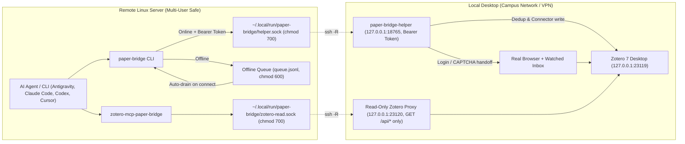

<p align="center">
  
</p>

<h1 align="center">zotero-paper-bridge</h1>

<p align="center">
  <strong>Ingest IEEE Xplore, arXiv, DOI, and BibTeX papers from remote Linux servers into your local Zotero 7 library over reverse SSH—and read full text back via private read-only MCP.</strong>
</p>

<p align="center">
  English | <a href="README.zh-CN.md">简体中文</a>
</p>

---

## Why `zotero-paper-bridge`?

When doing literature review or paper writing with an AI coding agent on a **remote Linux GPU server**, you hit two immediate walls:

1. **Institutional access lives on your laptop, not the GPU server.** IEEE Xplore and publisher portals require your campus network, VPN, or browser session—and headless scripts on datacenter IPs are immediately blocked.
2. **Forwarding Zotero port `23119` on a shared multi-user server is unsafe and fragile.** Port `23119` frequently collides with other users, and exposing TCP `127.0.0.1:23119` lets other users on the same host read or inject items into your Zotero library.

`zotero-paper-bridge` solves both with **zero third-party runtime dependencies** (pure Python 3.10+ standard library):

- **Least-privilege reverse SSH (no client `sshd`)**: Your laptop initiates `ssh -R` forwarding only two private `chmod 700` Unix Domain Sockets—never giving the server shell access to your personal computer.
- **Multi-user server isolation**:
  - `helper.sock` (`chmod 700` dir) + mandatory **256-bit Bearer Token** (`chmod 600`) for ingestion commands.
  - `zotero-read.sock` (`chmod 700` dir) routed through a **read-only local proxy** (`127.0.0.1:23120`) that allows only `GET`/`HEAD /api/*` and blocks all `POST`/`PUT`/`DELETE` and `/connector/*` writes with `403`.
- **Smart, strictly compliant tiered ingestion**:
  - Deduplicates against your local Zotero 7 library first (no duplicate items, zero Zotero 300 MB cloud quota consumed).
  - **Tier 1 (arXiv / Legal OA)**: Silent download with automatic arXiv HTTP 429 fallback (`/abs/` citation meta + OpenAlex) and OpenAlex/Unpaywall OA resolution.
  - **Tier 2 (IEEE Xplore campus/VPN)**: Polite serial direct fetch (3–6 s batch jitter + consecutive-block circuit breaker). Automatically extracts DOIs from downloaded PDFs (XMP / `/Info` / FlateDecode page-1 streams) to enrich sparse metadata via Crossref before saving.
  - **Tier 3 (Browser handoff — zero anti-bot evasion)**: Whenever a publisher requests institutional login or human verification, silent fetching stops immediately and hands off to your real local browser + desktop notification + watched inbox folder (`~/Downloads/paper-bridge-inbox`).
- **Offline queue with auto-drain**: Request papers on the remote server even when your laptop is asleep; the moment you reconnect the tunnel, queued papers drain automatically.
- **Works with any AI agent or plain CLI**: Includes a first-class **Antigravity plugin** plus ready-to-use setup guides for **Claude Code**, **OpenAI Codex CLI**, and **Cursor**.

---

## Architecture



---

## Platform Support

| Component | Platform | Status |
| :--- | :--- | :--- |
| **Remote Server** (`paper-bridge`, `zotero-mcp-paper-bridge`) | Linux (Ubuntu / Debian / RHEL, Python 3.10+) | Verified end-to-end |
| **Local Client** (`paper-bridge-helper`, `start-paper-bridge.ps1`) | Windows 10/11 + Zotero 7 | Verified end-to-end (arXiv, IEEE Xplore, full-text MCP read-back) |
| **Local Client** (`paper-bridge-helper`, `start-paper-bridge.sh`) | macOS / Linux Desktop + Zotero 7 | Implemented (standard POSIX + `osascript`/`notify-send`); community testing welcome |

---

## 3-Step Quick Start

### Step 1: Set up the remote Linux server

```bash
git clone https://github.com/yss-off/zotero-paper-bridge.git
cd zotero-paper-bridge

# Install CLI wrappers, generate 256-bit token, and (if present) install the Antigravity plugin
./scripts/install-server.sh

# Optional: build a zero-dependency portable client zip to copy to your laptop
./scripts/package-client-bundle.sh

# Print your shared Bearer token (paste into Step 2; never commit!)
cat ~/.config/paper-bridge/token
```

> **Optional MCP full-text read-back**: Ensure [`zotero-mcp`](https://github.com/54yyyu/zotero-mcp) is installed on the server (e.g., `uv tool install zotero-mcp` or `pip install '.[mcp]'`). `zotero-mcp-paper-bridge` automatically discovers it and routes it over `zotero-read.sock`.

### Step 2: Set up your local desktop (running Zotero 7)

1. Open **Zotero 7 Desktop**.
2. Enable **Settings → Advanced → Allow other applications on this computer to communicate with Zotero**.
3. Create a default inbox collection named **`Agent-Inbox`** in Zotero.

**On Windows (PowerShell):**

```powershell
# Option A: Extract the zero-dependency portable zip (no pip install needed!)
mkdir "$env:USERPROFILE\tools" -Force
scp user@my-gpu-server:~/code/zotero-paper-bridge/dist/zotero-paper-bridge-client.zip "$env:USERPROFILE\tools\"
Expand-Archive "$env:USERPROFILE\tools\zotero-paper-bridge-client.zip" -DestinationPath "$env:USERPROFILE\tools\" -Force
cd "$env:USERPROFILE\tools\zotero-paper-bridge"

# Save the shared Bearer token from Step 1
python -m paper_bridge.client.cli init --token "<YOUR_TOKEN>"

# Verify Zotero 7 read/write locally
.\scripts\client\smoke-test.ps1 -WriteTest
```

**On macOS / Linux desktop:**

```bash
git clone https://github.com/yss-off/zotero-paper-bridge.git ~/tools/zotero-paper-bridge
cd ~/tools/zotero-paper-bridge
python3 -m paper_bridge.client.cli init --token "<YOUR_TOKEN>"
./scripts/client/smoke-test.sh --write-test
```

### Step 3: Start the reverse SSH tunnel & ingest papers

**Windows:**
```powershell
.\scripts\client\start-paper-bridge.ps1 -SshHost my-gpu-server
```

**macOS / Linux:**
```bash
./scripts/client/start-paper-bridge.sh my-gpu-server
```

> Both launchers automatically detect your remote `$HOME` over SSH, clean stale sockets, start the local helper + read-only Zotero proxy, establish dual private Unix-socket reverse tunnels, and drain any queued papers on the server.
> For daily VS Code Remote-SSH / terminal sessions, see [scripts/client/ssh_config.example](scripts/client/ssh_config.example).

**Use from the remote server:**

```bash
# Check tunnel, Zotero 7, and offline queue status
paper-bridge health --json

# List all collections in your local Zotero library
paper-bridge collections

# Ingest a single paper (DOI, IEEE URL, arXiv ID, or title)
paper-bridge add "2504.12285" --collection "Agent-Inbox"
paper-bridge add "https://ieeexplore.ieee.org/document/11534231" --collection "Agent-Inbox"
paper-bridge add "10.1109/TWC.2024.1234567" --collection "Related-Work" --tag "baseline"

# Batch ingest from a .bib file or newline-separated list (serial with 3-6s jitter)
paper-bridge batch references.bib --collection "Related-Work" --wait

# Inspect or drain offline queue
paper-bridge queue list
paper-bridge drain --wait
```

---

## AI Coding Agent Integrations

| Agent | Integration Guide |
| :--- | :--- |
| **Antigravity** | Built-in plugin at [integrations/antigravity/zotero/](integrations/antigravity/zotero/README.md) (installed automatically by `./scripts/install-server.sh`) |
| **Claude Code** | [integrations/claude-code/README.md](integrations/claude-code/README.md) |
| **OpenAI Codex CLI** | [integrations/codex/README.md](integrations/codex/README.md) |
| **Cursor** | [integrations/cursor/README.md](integrations/cursor/README.md) |

---

## Academic Compliance & Security

- **Legitimate access only**: `zotero-paper-bridge` is designed solely to organize papers you already have authorized access to via your institution, campus network, VPN, or Open Access repositories. It **never** bypasses paywalls, solves CAPTCHAs, spoofs browser fingerprints, or queries unauthorized shadow libraries.
- **Security architecture**: See [SECURITY.md](SECURITY.md) for the full multi-user threat model and defenses.
- **Troubleshooting**: See [docs/troubleshooting.md](docs/troubleshooting.md) for Zotero 7 Local API setup, `SESSION_NOT_FOUND` cross-session behavior, and SSH socket forwarding fallbacks.

---

## Development & Tests

```bash
python3 -m pip install -e ".[dev]" httpx
pytest -v
ruff check .
```

## License

[MIT](LICENSE) © 2026 Shuieng
