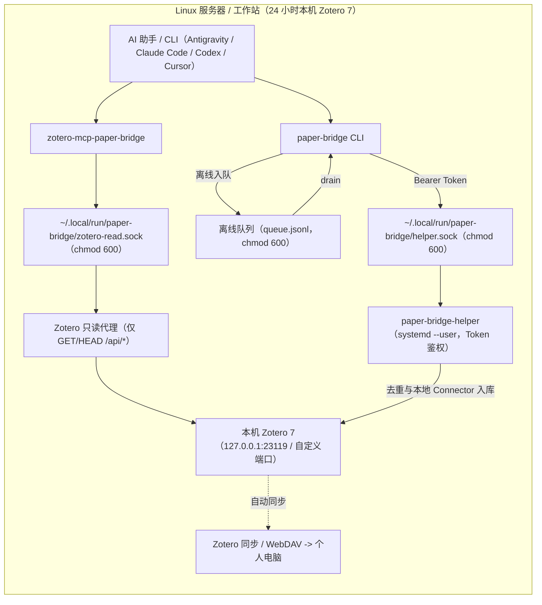

<p align="center">
  
</p>

<h1 align="center">zotero-paper-bridge</h1>

<p align="center">
  <strong>零第三方运行依赖的 Linux 本机 Zotero 7 文献入库守护进程与 CLI，支持 IEEE Xplore、arXiv、DOI 与 BibTeX 自动抓取入库，并经私有只读 Unix Socket 提供 MCP 全文读回。</strong>
</p>

<p align="center">
  <a href="README.md">English</a> | 简体中文
</p>

---

## 为什么做这个工具？

在接入校园网的 **Linux 工作站 / GPU 服务器**上使用 AI 编程助手调研文献、写论文时，直接在本机 24 小时运行 Zotero 7（配合 Zotero Sync / WebDAV 自动同步到个人电脑），可以彻底摆脱个人电脑开机和远程隧道依赖，同时解决两个关键问题：

1. **安全可控的多人服务器隔离**：
   - 入库通道：`~/.local/run/paper-bridge/helper.sock`（`chmod 700` 目录 + `chmod 600` Socket）+ 强制 **256-bit Bearer Token**（`chmod 600`，常量时间校验）。
   - 全文读回通道：`~/.local/run/paper-bridge/zotero-read.sock`（`chmod 600` Socket）接入**只读代理**，只放行 `GET`/`HEAD /api/*`，拦截所有 `POST`/`PUT`/`DELETE`/`PATCH` 与 `/connector/*` 写接口（返回 `403`）。
2. **合规多源分层入库与 PDF 元数据自动补全**：
   - 先查本机 Zotero 7 去重，再通过本地 Connector 接口写入（**不占用 Zotero 300 MB 官方云盘空间**，附件可经 WebDAV 自动同步到个人电脑）。
   - **Tier 1（arXiv / 合法开放获取）**：静默直下；当 `export.arxiv.org` 在校内共享 IP 触发 `HTTP 429` 时自动降级解析 `/abs/` 页面的规范 `citation_*` 标签与 OpenAlex。
   - **Tier 2（IEEE Xplore 校园网）**：串行低速直取（批量每篇 3–6 秒随机间隔 + 连续受限自动熔断）；裸 IEEE 链接预取元数据不足时，下载 PDF 后自动从 PDF XMP / `/Info` / 首页压缩流提取 DOI 并反查 Crossref 补全标题、作者、期刊与年份。
   - **Tier 3（人工补全，零反爬绕过）**：遇到机构登录或人机验证立刻停止静默请求，自动保存元数据并打上 `needs-pdf` 标签；之后把手动下载的 PDF 放到 `~/Downloads/paper-bridge-inbox` 运行 `paper-bridge scan-inbox` 即可自动补挂。
3. **离线队列与恢复**：Zotero 或本地助手短暂离线时，任务保存在 `queue.jsonl`（`chmod 600`），恢复后一键 `paper-bridge drain --wait` 续跑并核对逐篇结果。
4. **不绑定单一 AI 工具**：既可独立命令行使用，也内置 **Antigravity 插件包**，并提供 **Claude Code**、**OpenAI Codex CLI** 与 **Cursor** 的即插即用接入说明。

---

## 系统架构



---

## 3 步快速上手

### 第 1 步：配置本机 Zotero 7

1. 在 Linux 服务器/工作站上启动 **Zotero 7**。
2. 开启 **设置 → 高级 → 允许此计算机上的其他应用程序与 Zotero 通信**（`extensions.zotero.httpServer.localAPI.enabled = true`）。
3. 在 Zotero 中新建默认收件箱分类：**`Agent-Inbox`**。

### 第 2 步：安装命令、Token 与插件

```bash
git clone https://github.com/yss-off/zotero-paper-bridge.git
cd zotero-paper-bridge

# 软链 CLI/助手/MCP 到 ~/.local/bin，生成共享 256-bit Token，初始化本机配置，并自动注册 Antigravity 插件
./scripts/install-server.sh
```

> **启用 MCP 全文读回**需要安装 `zotero-mcp`（例如 `uv tool install zotero-mcp` 或 `pip install '.[mcp]'`）。`zotero-mcp-paper-bridge` 会自动定位其 Python 环境，默认通过私有 `zotero-read.sock` 读取。

如果本机 Zotero 修改过 HTTP 端口（例如 `23137`），请修改 `~/.paper-bridge/config.toml` 中的 `zotero_base_url`：

```toml
zotero_base_url = "http://127.0.0.1:23137"
```

先做一次连通性冒烟检查：

```bash
paper-bridge-helper smoke-test
```

### 第 3 步：启动本机守护进程（推荐 `systemd --user` 常驻）

前台调试启动：

```bash
paper-bridge-helper serve --no-browser
```

24 小时常驻运行：

```bash
mkdir -p ~/.config/systemd/user
cp scripts/paper-bridge-helper.service.example ~/.config/systemd/user/paper-bridge-helper.service
systemctl --user daemon-reload
systemctl --user enable --now paper-bridge-helper.service
```

随后即可在终端或任意 AI 助手中使用：

```bash
# 检查本机助手、Zotero 7、Local API 与离线队列状态
paper-bridge health --json

# 列出 Zotero 中的所有分类目录
paper-bridge collections

# 单篇下载入库（支持 DOI、IEEE 链接、arXiv ID 或论文标题）
paper-bridge add "2504.12285" --collection "Agent-Inbox"
paper-bridge add "https://ieeexplore.ieee.org/document/11534231" --collection "Agent-Inbox"
paper-bridge add "10.1109/TPAMI.2016.2577031" --collection "Related-Work" --tag "baseline"

# 批量汇总（支持 .bib 或逐行列表，串行 3-6 秒限速）
paper-bridge batch references.bib --collection "Related-Work" --wait

# 查看或排空离线队列
paper-bridge queue list
paper-bridge drain --wait
```

用 `paper-bridge queue retry <TASK_ID>` 可将 `failed`、`needs_attention` 或 `submitted` 任务退回 `pending`，下次运行 `drain` 时会重新提交。

---

## 主流 AI 编程助手接入

| AI 工具 | 接入文档 |
| :--- | :--- |
| **Antigravity** | 内置完整插件包 [integrations/antigravity/zotero/](integrations/antigravity/zotero/README.md)（运行 `./scripts/install-server.sh` 自动安装） |
| **Claude Code** | [integrations/claude-code/README.md](integrations/claude-code/README.md) |
| **OpenAI Codex CLI** | [integrations/codex/README.md](integrations/codex/README.md) |
| **Cursor** | [integrations/cursor/README.md](integrations/cursor/README.md) |

---

## 学术合规与安全声明

- **仅限合法授权访问**：本工具仅用于整理用户通过所在机构、校园网或合法开放获取渠道本就拥有访问权限的学术文献。项目**严禁且不包含**任何验证码识别、反爬绕过、指纹伪造或盗版文献源。
- **安全模型**：详见 [SECURITY.md](SECURITY.md)。
- **常见问题排障**：详见 [docs/troubleshooting.md](docs/troubleshooting.md)（含 Zotero 7 Local API 开启方式、自定义端口、`SESSION_NOT_FOUND` 跨会话限制与读回探针）。

---

## 开发与测试

```bash
python3 -m pip install -e ".[dev]" httpx
pytest -v
ruff check .
```

## 开源协议

[MIT](LICENSE) © 2026 Shuieng
