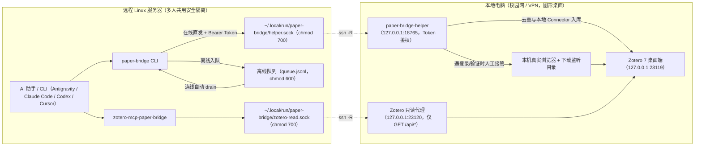

<p align="center">
  
</p>

<h1 align="center">zotero-paper-bridge</h1>

<p align="center">
  <strong>通过反向 SSH 从远程 Linux 服务器把 IEEE Xplore、arXiv、DOI 与 BibTeX 文献安全汇总到本地 Zotero 7，并经私有只读 MCP 读回全文。</strong>
</p>

<p align="center">
  <a href="README.md">English</a> | 简体中文
</p>

---

## 为什么做这个工具？

在**远程 Linux GPU 服务器**上借助 AI 编程助手调研文献、写论文时，通常会遇到两个痛点：

1. **机构下载权限在本地电脑，不在服务器上**：IEEE Xplore 等数据库需要校园网 IP、校园 VPN 或本机浏览器机构登录态，直接从服务器抓取往往被拒或被拦截。
2. **多人共用服务器上直接转发 Zotero `23119` 端口既易冲突又不安全**：端口容易被其他用户占用，且开放 TCP `127.0.0.1:23119` 后同机其他用户理论上可以读取甚至通过 Connector 写入你的 Zotero。

`zotero-paper-bridge` 用**零第三方运行依赖**（纯 Python 3.10+ 标准库）把整条链路做成了最小权限闭环：

- **最小权限反向 SSH（无需在本地装 `sshd`）**：由你的个人电脑主动发起 `ssh -R`，仅映射两个位于 `chmod 700` 目录下的私有 Unix Domain Socket，绝不向服务器开放你本机的终端执行权限。
- **多人服务器双重安全隔离**：
  - 写入/下载通道：`helper.sock`（`chmod 700` 目录）+ 强制 **256-bit Bearer Token**（Linux `chmod 600` / Windows 当前用户独享 ACL）。
  - 全文读回通道：`zotero-read.sock`（`chmod 700` 目录）接入本地**只读代理**（`127.0.0.1:23120`），只放行 `GET`/`HEAD /api/*`，拦截所有 `POST`/`PUT`/`DELETE` 和 `/connector/*` 写接口（返回 `403`）。
- **合规多源分层入库与 PDF 元数据自动补全**：
  - 先查本机 Zotero 7 去重（不重复建条目，且走本地 Connector 接口，**不占用 Zotero 300 MB 官方云盘空间**）。
  - **Tier 1（arXiv / 合法开放获取）**：静默直下；当 `export.arxiv.org` 在校内共享 IP 触发 `HTTP 429` 时自动降级解析 `/abs/` 页面的规范 `citation_*` 标签与 OpenAlex。
  - **Tier 2（IEEE Xplore 校园网/VPN）**：串行低速直取（批量每篇 3–6 秒随机间隔 + 连续受限自动熔断）；裸 IEEE 链接预取元数据不足时，下载 PDF 后自动从 PDF XMP / `/Info` / 首页压缩流提取 DOI 并反查 Crossref 补全标题、作者、期刊与年份。
  - **Tier 3（浏览器人工接管，零反爬绕过）**：遇到机构登录或人机验证立刻停止静默请求，自动切回你的真实浏览器并弹系统通知；批量模式先入元数据（`needs-pdf`）并生成本地清单页，手动下载到 `~/Downloads/paper-bridge-inbox` 后一键自动补挂。
- **离线队列自动补下**：本地电脑离线或合盖时，服务器下发的任务自动写入 `queue.jsonl`，本地隧道一连上即自动排空补下。
- **不绑定单一 AI 工具**：既可独立命令行使用，也内置 **Antigravity 插件包**，并提供 **Claude Code**、**OpenAI Codex CLI** 与 **Cursor** 的即插即用接入说明。

---

## 系统架构



---

## 平台支持矩阵

| 组件 | 平台 | 验证状态 |
| :--- | :--- | :--- |
| **远程服务端**（`paper-bridge`、`zotero-mcp-paper-bridge`） | Linux（Ubuntu / Debian / RHEL，Python 3.10+） | 已端到端真机实测 |
| **本地客户端**（`paper-bridge-helper`、`start-paper-bridge.ps1`） | Windows 10/11 + Zotero 7 | 已端到端真机实测（arXiv、IEEE Xplore 与 MCP 全文读回） |
| **本地客户端**（`paper-bridge-helper`、`start-paper-bridge.sh`） | macOS / Linux 桌面 + Zotero 7 | 已实现（POSIX 脚本 + `osascript`/`notify-send`），欢迎社区反馈实测结果 |

---

## 3 步快速上手

### 第 1 步：初始化远程 Linux 服务器

```bash
git clone https://github.com/yss-off/zotero-paper-bridge.git
cd zotero-paper-bridge

# 安装命令软链、生成 256-bit 随机 Token，并自动注册 Antigravity 插件（如检测到 ~/.gemini/config）
./scripts/install-server.sh

# 可选：打包一份零第三方依赖的便携客户端 zip 供复制到本地电脑
./scripts/package-client-bundle.sh

# 查看共享 Bearer Token（复制到第 2 步使用，切勿提交到 Git）
cat ~/.config/paper-bridge/token
```

> **启用 MCP 全文读回**：确保服务器已安装 `zotero-mcp`（例如 `uv tool install zotero-mcp` 或 `pip install '.[mcp]'`）。`zotero-mcp-paper-bridge` 会自动定位其 Python 环境并切到私有 `zotero-read.sock`。

### 第 2 步：配置本地电脑（运行 Zotero 7）

1. 打开 **Zotero 7 桌面端**。
2. 勾选 **设置 → 高级 → 允许此计算机上的其他应用程序与 Zotero 通信**。
3. 在 Zotero 中新建一个默认收件箱分类：**`Agent-Inbox`**。

**Windows（PowerShell）：**

```powershell
# 拉取并解压零依赖便携包（无需 pip install）
mkdir "$env:USERPROFILE\tools" -Force
scp user@my-gpu-server:~/code/zotero-paper-bridge/dist/zotero-paper-bridge-client.zip "$env:USERPROFILE\tools\"
Expand-Archive "$env:USERPROFILE\tools\zotero-paper-bridge-client.zip" -DestinationPath "$env:USERPROFILE\tools\" -Force
cd "$env:USERPROFILE\tools\zotero-paper-bridge"

# 写入第 1 步的共享 Token
python -m paper_bridge.client.cli init --token "<你的TOKEN>"

# 本地冒烟测试（验证 Zotero 7 读写）
.\scripts\client\smoke-test.ps1 -WriteTest
```

**macOS / Linux 桌面：**

```bash
git clone https://github.com/yss-off/zotero-paper-bridge.git ~/tools/zotero-paper-bridge
cd ~/tools/zotero-paper-bridge
python3 -m paper_bridge.client.cli init --token "<你的TOKEN>"
./scripts/client/smoke-test.sh --write-test
```

### 第 3 步：启动反向隧道并开始汇总文献

**Windows：**
```powershell
.\scripts\client\start-paper-bridge.ps1 -SshHost my-gpu-server
```

**macOS / Linux：**
```bash
./scripts/client/start-paper-bridge.sh my-gpu-server
```

> 启动脚本会自动探测远程 `$HOME`（零用户名硬编码）、清理残留 Socket、拉起本地助手与只读代理、建立双私有 Socket 反向隧道，并自动排空服务端离线队列。日常使用 VS Code Remote-SSH 或终端直连时，可参考 [scripts/client/ssh_config.example](scripts/client/ssh_config.example)。

**在远程服务器终端使用：**

```bash
# 检查隧道、Zotero 7 与离线队列状态
paper-bridge health --json

# 列出 Zotero 中的所有分类目录
paper-bridge collections

# 单篇下载入库（支持 DOI、IEEE 链接、arXiv ID 或论文标题）
paper-bridge add "2504.12285" --collection "Agent-Inbox"
paper-bridge add "https://ieeexplore.ieee.org/document/11534231" --collection "Agent-Inbox"
paper-bridge add "10.1109/TWC.2024.1234567" --collection "Related-Work" --tag "baseline"

# 批量汇总（支持 .bib 或逐行列表，串行 3-6 秒限速）
paper-bridge batch references.bib --collection "Related-Work" --wait

# 查看或手动排空离线队列
paper-bridge queue list
paper-bridge drain --wait
```

---

## 主流 AI 编程助手接入

| AI 工具 | 接入文档 |
| :--- | :--- |
| **Antigravity** | 内置完整插件包 [integrations/antigravity/zotero/](integrations/antigravity/zotero/README.md)（运行 `./scripts/install-server.sh` 自动安装） |
| **Claude Code** | [integrations/claude-code/README.md](integrations/claude-code/README.md) |
| **OpenAI Codex CLI** | [integrations/codex/README.md](integrations/codex/README.md) |
| **Cursor** | [integrations/cursor/README.md](integrations/cursor/README.md) |

---

## 学术合规与安全声明

- **仅限合法授权访问**：本工具仅用于整理用户通过所在机构、校园网、VPN 或合法开放获取渠道本就拥有访问权限的学术文献。项目**严禁且不包含**任何验证码识别、反爬绕过、指纹伪造或盗版文献源。
- **安全模型**：详见 [SECURITY.md](SECURITY.md)。
- **常见问题排障**：详见 [docs/troubleshooting.md](docs/troubleshooting.md)（含 Zotero 7 Local API 开启方式、`SESSION_NOT_FOUND` 跨会话限制说明及 SSH 转发排障）。

---

## 开发与测试

```bash
python3 -m pip install -e ".[dev]" httpx
pytest -v
ruff check .
```

## 开源协议

[MIT](LICENSE) © 2026 Shuieng
